# Learning Unit Import Run User Guide

This guide explains how to import learning units from Google Sheets into LMS using **Learning Unit Import Source** and **Learning Unit Import Run**.

Use this process when activities for a program are ready in the content sheets and you want LMS to create the matching Course Levels, Assignments, Video Classes, Quizzes and Learning Units.

## What this process does

There are two records:

- **Learning Unit Import Source**: set up once per program. It says where the content sheet is, which program the Course Levels belong to, and where to write assignment IDs back.
- **Learning Unit Import Run**: created every time you import. It lists one or more sources, which activities to pick, and whether it is a dry run.

For every activity row it picks, a run:

1. Finds or creates the **Course Level** for the program, course and level.
2. Creates the **Assignment**, **Video Class** (with language translations) and **Quiz** for the activity.
3. Creates the **Learning Unit** and links it to the Course Level in the next free week.
4. Writes the new assignment IDs into the **Assignment Flow Sheet**.

Sources run one after another in the background. A failed source does not stop the sources after it.

## Before you start

### 1. Share the Google Sheets

Share the sheets with this service account email address:

```text
data-migration@rubrics-data-migration.iam.gserviceaccount.com
```

| Sheet | Access needed |
| --- | --- |
| Content sheet (master index or source tabs) | Viewer |
| Every activity sheet linked from the master index | Viewer |
| Assignment Flow Sheet | **Editor** |

If a sheet is not shared, the run fails with `Google Sheets API failed 403 ... The caller does not have permission`.

### 2. Check the program

The **Course Level Program** you pick on the source must already exist in LMS.


## Part 1: Set up a Learning Unit Import Source

You only need to do this once per program. After that, reuse the source in every run.

Open **Learning Unit Import Source** from the search bar, then click **+ Add Learning Unit Import Source**.

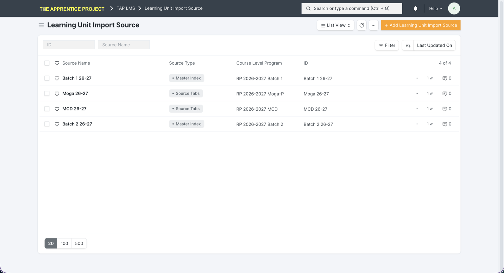

### Choose the source type

| Source Type | Use it when |
| --- | --- |
| **Master Index** | One "master" sheet lists every course and level, with a link to a separate activity sheet for each. |
| **Source Tabs** | One spreadsheet holds the activities, with one tab per grade. |

### Master Index source

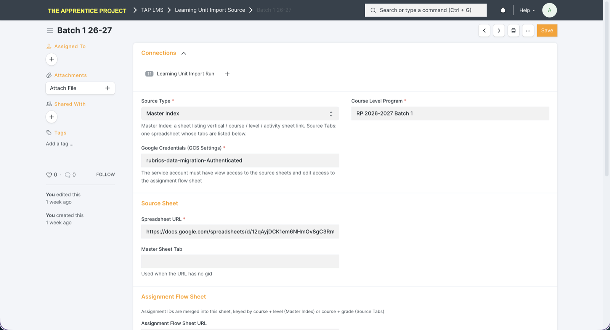

| Field | What to enter |
| --- | --- |
| Source Name | A short name, for example `Batch 1 26-27`. This becomes the record ID. |
| Source Type | `Master Index` |
| Google Credentials (GCS Settings) | The credentials record for the service account. Use `rubrics-data-migration-Authenticated` |
| Course Level Program | The program the Course Levels belong to, for example `RP 2026-2027 Batch 1`. |
| Spreadsheet URL | Link to the master sheet. Copy it while the right tab is open so the link includes `gid=`. |
| Master Sheet Tab | Only needed if the URL has no `gid`. Enter the exact tab name. |

The master tab needs these columns. LMS finds them by header name. If it can't, it uses the column letter shown below.

| Column | Header contains | Example |
| --- | --- | --- |
| A | `Vertical` | `STEM-Coding`, `STEM-Science`, `VA`, `Fin-Lit` |
| B | `Course` | `Art for Everyday Life` |
| C | `Level` | `Level 0` |
| D | `Link`, `Sheet` or `Implementation` | A link to the activity sheet for that course and level |

You can leave the vertical blank on rows below the first one; LMS uses the vertical from the row above. Rows with no course, level or link are ignored.

### Source Tabs source

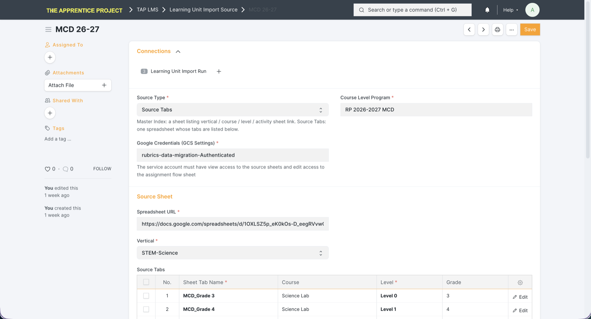

Fill in the same top fields, then:

| Field | What to enter |
| --- | --- |
| Spreadsheet URL | Link to the spreadsheet that holds the tabs. |
| Vertical | The vertical for every tab: `STEM-Coding`, `STEM-Science`, `VA` or `Fin-Lit`. |
| Source Tabs | One row per tab to import (see below). |

For each Source Tabs row:

| Column | What to enter |
| --- | --- |
| Sheet Tab Name | The exact tab name, for example `MCD_Grade 3`. |
| Course | The course name. Leave it blank to use the tab name. |
| Level | The level, for example `Level 0`. |
| Grade | The grade. LMS uses it to find the right row in the Assignment Flow Sheet. |

### Assignment Flow Sheet and Defaults

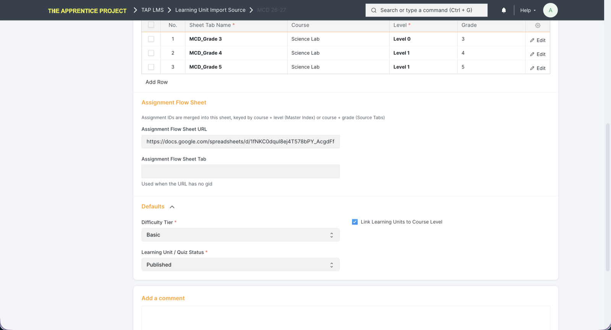

| Field | What to enter |
| --- | --- |
| Assignment Flow Sheet URL | Link to the sheet where assignment IDs should be written. The service account needs **Editor** access. |
| Assignment Flow Sheet Tab | Only needed if the URL has no `gid`. |
| Difficulty Tier | Tier set on new Learning Units. The default is `Basic`. |
| Learning Unit / Quiz Status | Status set on new Learning Units and Quizzes. The default is `Published`. |
| Link Learning Units to Course Level | Leave this ticked so each Learning Unit is added to its Course Level as a new week. |

Assignment IDs are matched to rows in the Assignment Flow Sheet:

- Master Index sources match on **course + level**.
- Source Tabs sources match on **course + grade**.

Click **Save**.

## Part 2: Run an import

### 1. Create a new run

Open **Learning Unit Import Run** and click **+ Add Learning Unit Import Run**.

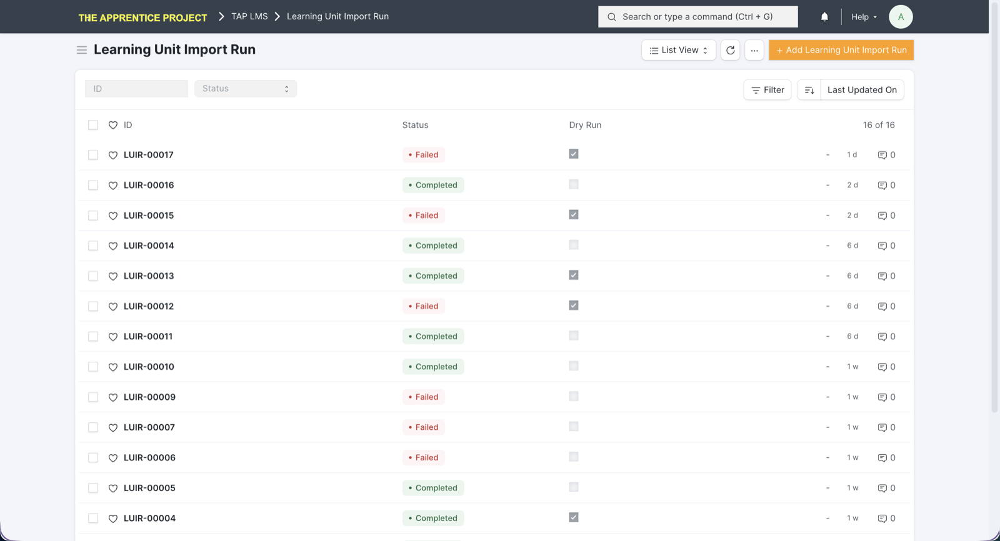

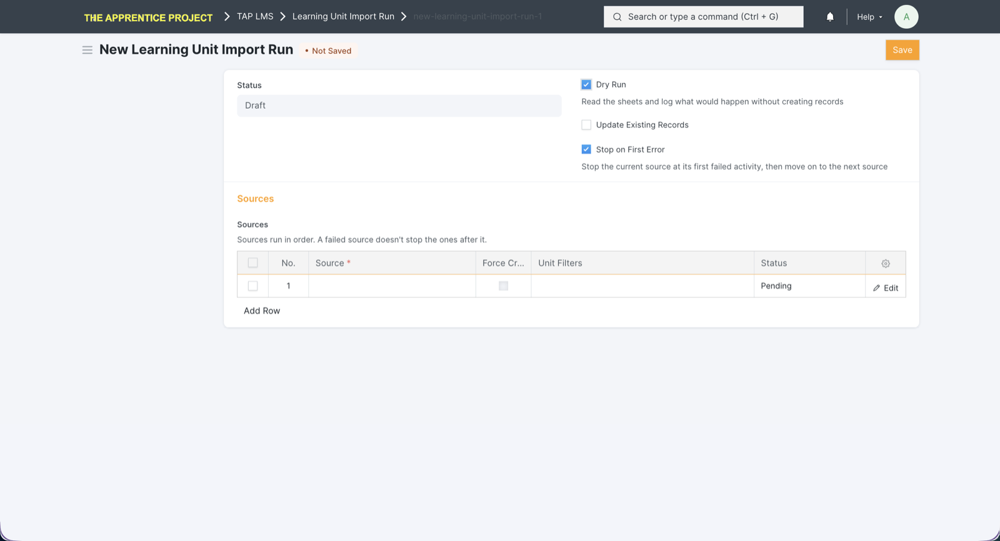

| Option | What it does |
| --- | --- |
| Dry Run | **On by default.** Reads the sheets and logs what would happen, without creating any records or writing to the Assignment Flow Sheet. |
| Update Existing Records | When on, records that already exist are updated from the sheet. When off, they are skipped. |
| Stop on First Error | When on, a source stops at its first failed activity. The run then moves on to the next source. |

### 2. Add sources

Add one row per source in the **Sources** table. Click **Edit** on a row to see all its fields.

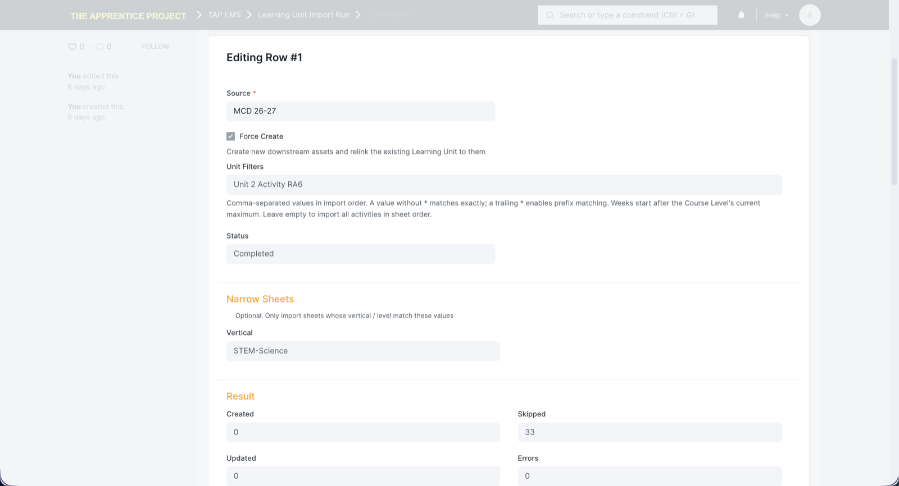

| Field | What to enter |
| --- | --- |
| Source | The Learning Unit Import Source to read from. |
| Force Create | Creates a new Assignment, Video Class and Quiz even if they already exist, and relinks the existing Learning Unit to the new ones. `Always keep this checked.` |
| Unit Filters | Which activities to import. See below. |
| Vertical / Level (Narrow Sheets) | Optional. Only reads sheets with this vertical and/or level. |

You can add the same source more than once, for example with different filters or levels.

#### Unit Filters

The filter values are matched against the activity code in **column A** of the activity sheet, for example `Unit 2 Activity RA6`.

| Filter | Imports |
| --- | --- |
| *(empty)* | Every activity, in sheet order. |
| `Unit 2 Activity RA6` | Only that exact activity. |
| `Unit 3 Activity RA9, Unit 3 Activity CA1` | Those two activities, in that order. |
| `Unit 2*` | Every activity whose code starts with `Unit 2`. Like Unit 2 and Unit 21 |

Rules:

- Separate values with commas. Each value's position sets the import order.
- The same value can't appear twice in one row.
- New Learning Units go into the week after the Course Level's current last week. For example, if Level 0 already has weeks 1 to 10, the next activity becomes week 11.

### 3. Start a dry run

Save the run. While it is in **Draft**, the button at the top says **Start Dry Run**; when Dry Run is unticked, it says **Start Import**. Click the button.

The status changes to **Queued**, then **Running**. A blue bar at the top shows which source is running and how many activities it has processed. When the run finishes, the page reloads automatically.

Once a run has started it can't be edited. To change anything, create a new run (see step 5).

### 4. Check the dry run result

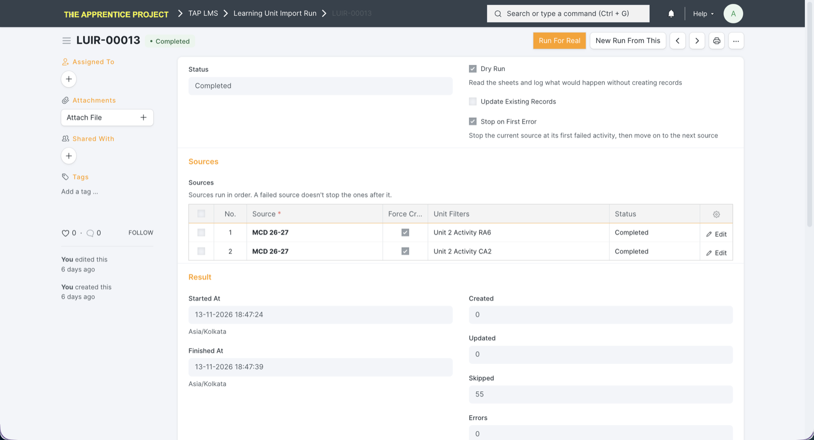

- Each row in **Sources** shows its own status.
- **Result** shows the start and end time and the total counts.
- **Activities** lists every activity the run processed.

> **In a dry run every record counts as Skipped**, because nothing is written. Use the log and the Activities table to check what *would* be created.

The counts are per record, not per activity. One activity usually creates several records: Course Level, Assignment, Video Class, Quiz, quiz questions and Learning Unit.

Click **Edit** on a Sources row and scroll down to read its **Log**. Check that:

- the expected sheets were matched (`Matched N course/level sheets`)
- the right activities were picked (`Matched 1 activity rows for ...`)
- each bundle ends with the expected week number (`Bundle ready: ... | week=1 | ...`)

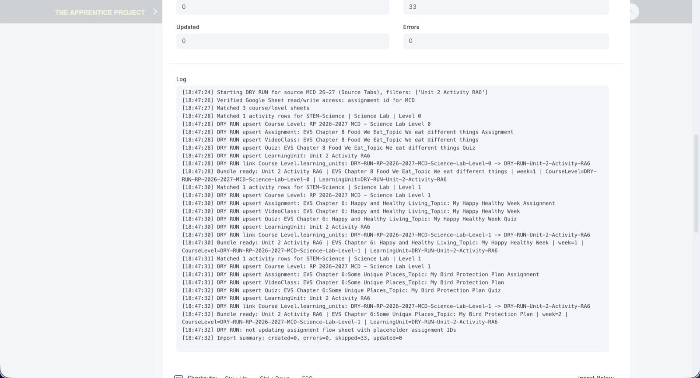

### 5. Run it for real

When the dry run looks right, use one of the buttons at the top of the finished run:

| Button | What it does |
| --- | --- |
| **Run For Real** | Shown on dry runs only. Opens a copy of the run with Dry Run turned off. |
| **New Run From This** | Opens a copy with the same settings, for example to retry a failed run. |

Both buttons open an unsaved copy with the same sources and filters, and every source reset to **Pending**.

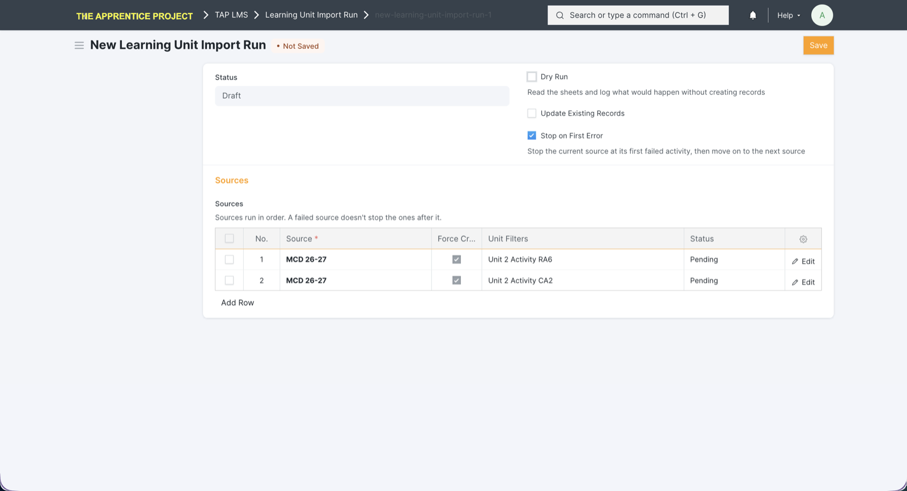

Click **Save**, then **Start Import**. LMS asks you to confirm, because a real run creates records and writes to the Assignment Flow Sheet. Click **Yes**.

### 6. Check the real run

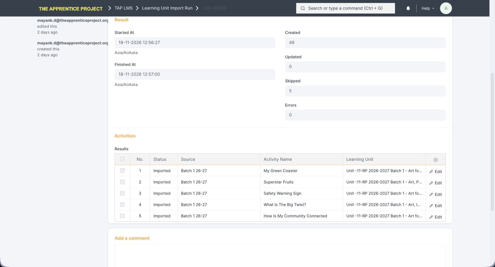

Click **Edit** on an Activities row to see the exact sheet row and the records it created. Each link opens that record.

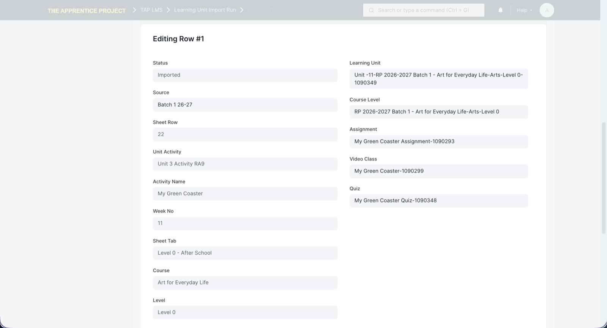

| Activity status | Meaning |
| --- | --- |
| Imported | The records were created or updated (or would have been, in a dry run). |
| Skipped | The activity was not imported. The **Message** says why. |
| Error | The activity failed. The **Message** has the error. |

After a real run, check that the assignment IDs appear in the Assignment Flow Sheet.

## Run statuses

| Status | Meaning |
| --- | --- |
| Draft | Saved but not started. Only Draft runs can be edited. |
| Queued | Waiting for a background worker. |
| Running | Importing now. |
| Completed | Every source finished without errors. |
| Completed With Errors | At least one source had errors or failed, but not all of them. |
| Failed | Every source failed. The **Error** field lists the failed sources. |

Every source row also has its own status: Pending, Running, Completed, Completed With Errors or Failed.

## Troubleshooting

When a source fails, the run's **Error** field names it. Open that source row with **Edit** to see the full error and the log.

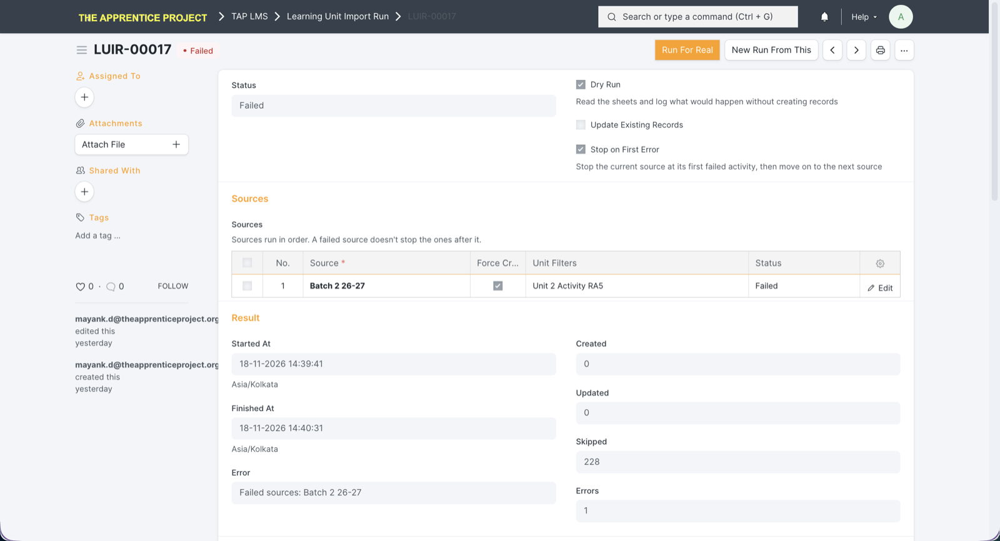

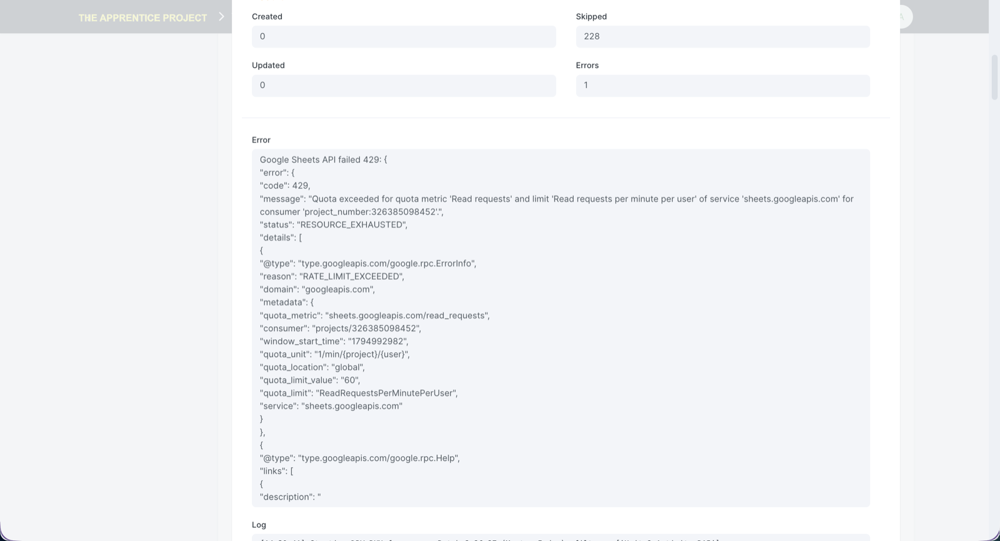

| Error or message | What to do |
| --- | --- |
| `Google Sheets API failed 403 ... The caller does not have permission` | Share the sheet with the service account (see [Before you start](#1-share-the-google-sheets)), then start a new run. |
| `Google Sheet preflight failed before any Frappe update ...` | The service account can't edit the Assignment Flow Sheet. Give it **Editor** access. Nothing was imported. |
| `Google Sheets API failed 429 ... Quota exceeded` | Google's limit of 60 read requests per minute was reached. Wait a minute, then use **New Run From This**. Narrow the run with Unit Filters or Vertical/Level so it reads fewer sheets. |
| `duplicate key value violates unique constraint "unique_quiz_name"` | A quiz with that name already exists. Turn on **Update Existing Records** or **Force Create**, or rename the activity in the sheet. |
| `Skipped: Valid/Invalid not found` | The activity's Valid/Invalid column (column HK, submission guidelines) is empty. Fill it in and import that activity again. |
| `No source entries match vertical=..., level=...` | The Vertical/Level filters on the source row don't match any sheet. Check them, or leave them blank. |
| `Configured source sheet tab not found` | A Sheet Tab Name on the source doesn't match a tab in the spreadsheet. Fix the name on the source. |
| `Sources row N (...): Duplicate value in Unit Filters` | Remove the repeated filter value, then save again. |
| `Run LUIR-xxxxx is still in progress for one of these sources` | Another run is using the same source. Wait for it to finish, then start again. |
| `This run has already started and can't be edited` | Use **New Run From This** to make an editable copy. |

## Quick checklist

1. The sheets are shared with the service account, with Editor access to the Assignment Flow Sheet.
2. The source exists, with the right program, spreadsheet URL and flow sheet.
3. You created a run with **Dry Run** ticked, added the sources and set the Unit Filters.
4. You started the dry run and checked the counts, Activities and each source's Log.
5. You clicked **Run For Real**, then **Save**, then **Start Import**, and confirmed.
6. You checked the Activities table and the Assignment Flow Sheet.
