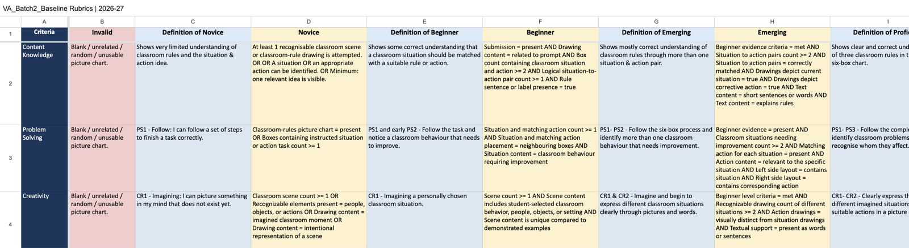
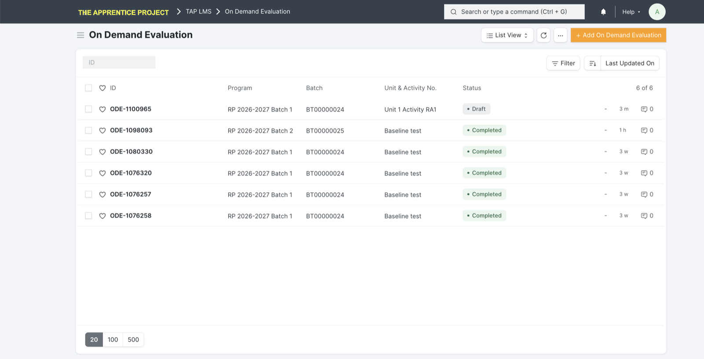
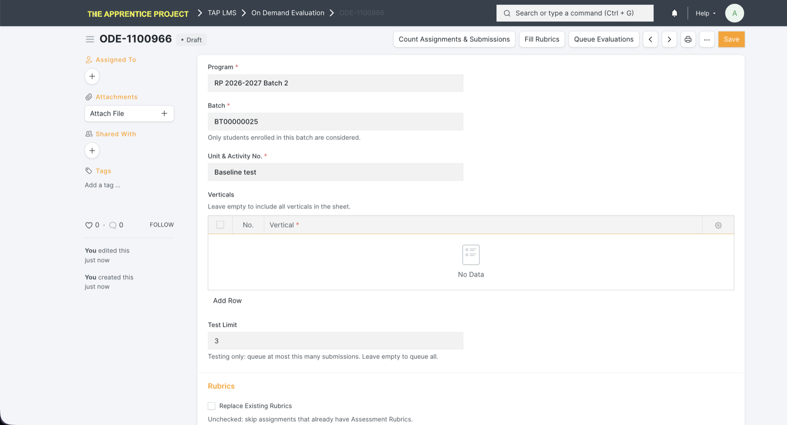
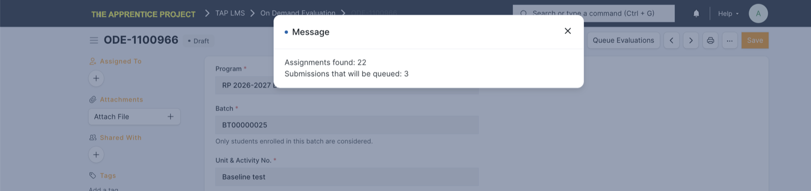
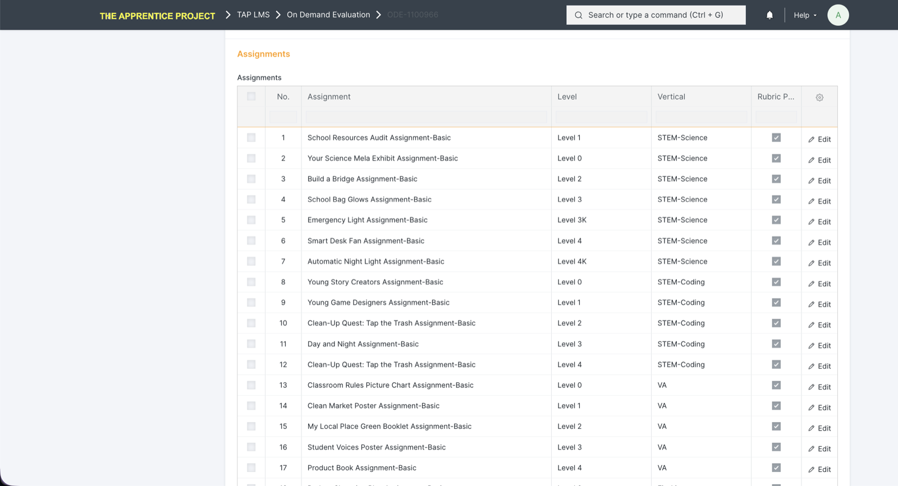
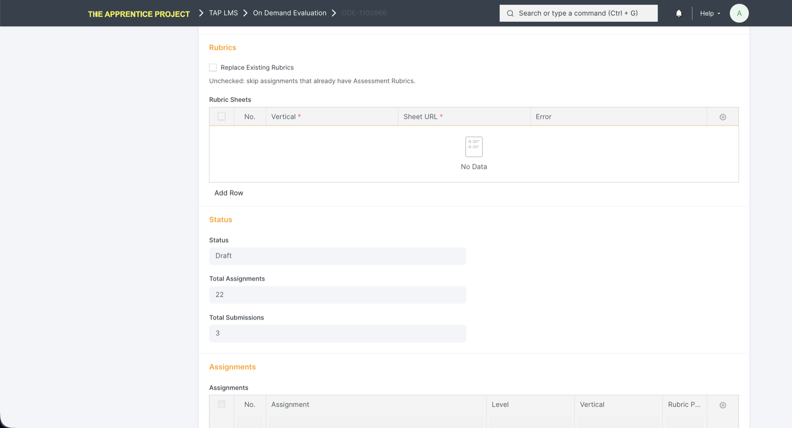
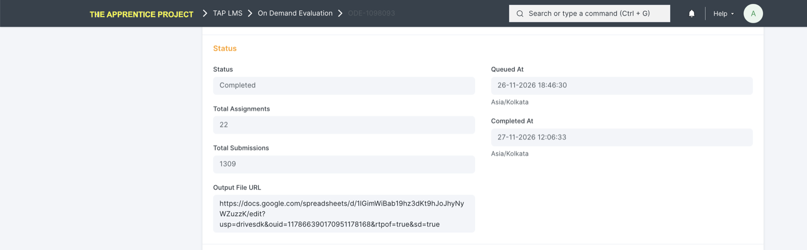
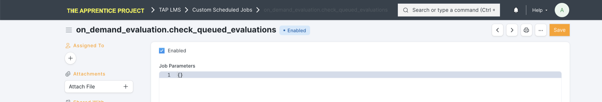
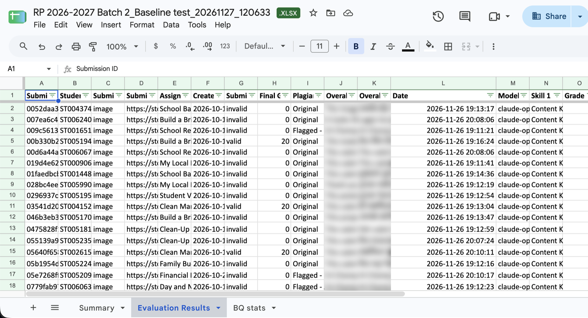

# On Demand Evaluation User Guide

This guide explains how to grade student submissions against assessment rubrics using the **On Demand Evaluation** job in LMS.

Use this process when you want the AI evaluator to grade every submission of one unit and activity (for example, the Baseline test) for one batch, and get the results in a Google Sheet.

## What this process does

1. LMS reads the learning-unit Google Sheet and finds the assignments listed for your **Program** and **Unit & Activity No.**
2. It collects the submissions for those assignments from students enrolled in your **Batch**. Text and emoji submissions, and submissions without an image or text, are left out.
3. Optionally, it fills the **Assessment Rubrics** of those assignments from your rubric sheets.
4. When you queue the job, every submission is sent to the AI evaluator, which grades each rubric criterion.
5. Every 2 hours LMS checks the job. When all submissions are graded, it saves a results Google Sheet in Google Drive and marks the job **Completed**.

## Before you start

### 1. You need the System Manager role

Only users with the **System Manager** role can create and run On Demand Evaluation jobs.

### 2. Check the learning-unit sheet

LMS finds the assignments in this sheet:

```text
https://docs.google.com/spreadsheets/d/1nSN72ikEqM7U0gMl-3AoOV8KeHAzNZvK_zHCNcT6B34
```

- Each tab is named `<vertical> <level>`, for example `VA Level 2` or `STEM-Coding Level 0`.
- Each tab has the columns `Unit & Activity No.`, `Program` and `Assignment`.
- The `Assignment` cell can hold several assignment IDs separated by commas.

The **Program** and **Unit & Activity No.** you enter in LMS must match the values in this sheet. Capital letters and extra spaces are ignored.

### 3. Prepare the rubric sheets (only if you will use Fill Rubrics)

Create one Google Sheet per vertical. Use this sheet as the sample:

```text
https://docs.google.com/spreadsheets/d/1ETV0iNgRS-nUEcCO0WGoRAHxi6X5wLiilUB6UHNk-xA/edit?gid=1427053130#gid=1427053130
```



**Tabs:** one tab per level. The tab name must contain the level, for example `Level0`, `Level 2`, `L3` or `Level 3K`. Each level must have exactly one visible tab. Hidden tabs are ignored.

**Header row:** the header row must contain these six column names, spelled **exactly** like this:

| Column | Grade value |
| --- | --- |
| `Invalid` | -1 |
| `Novice` | 1 |
| `Beginner` | 2 |
| `Emerging` | 3 |
| `Proficient` | 4 |
| `Expert` | 5 |

> [!IMPORTANT]
> The grade column names must be exactly the same as in the table above. If any of them is missing or spelled differently (for example `Proficiency` or `Expert Level`), Fill Rubrics fails for that sheet with the error `header row is missing grade columns [...]`.

- Add a `Criteria` column with the criterion name on each row, for example `Content Knowledge`, `Problem Solving` or `Creativity`. If there is no `Criteria` column, LMS uses column A.
- Other columns, such as `Definition of Novice`, are allowed and ignored.
- Rows with an empty criterion are skipped.

### 4. Share the sheets

Share the rubric sheets with this email address before running Fill Rubrics:

```text
data-migration@rubrics-data-migration.iam.gserviceaccount.com
```

Viewer access is enough. If a sheet is not shared, the row shows a permission error.

## Step 1: Open On Demand Evaluation

Open:

```text
https://tap-lms.theapprenticeproject.org/app/on-demand-evaluation
```



## Step 2: Create a new job

Click **Add On Demand Evaluation** and fill these fields:

| Field | What to enter |
| --- | --- |
| Program | The program, for example `RP 2026-2027 Batch 2` |
| Batch | The batch ID. Only students enrolled in this batch are included. |
| Unit & Activity No. | As written in the learning-unit sheet, for example `Baseline test` |
| Verticals | Optional. Add rows to limit the job to some verticals. Leave empty to include all. |
| Test Limit | Optional, for testing only. Queues at most this many submissions. Leave empty to queue all. |

Click **Save**. The job is created with the status **Draft**, and three buttons appear at the top.



## Step 3: Count assignments and submissions

Click **Count Assignments & Submissions**. This changes nothing except the counts on the job, so you can run it as often as you like.

LMS shows how many assignments it found and how many submissions it will queue.



Then scroll down to the **Assignments** table and check it:

- **Assignment** is blank: the assignment ID in the sheet does not exist in LMS. Fix the sheet or create the assignment.
- **Rubric Present** is unticked: the assignment has no assessment rubrics. Run Step 4, or add the rubrics on the assignment.



## Step 4: Fill rubrics (optional)

Skip this step if every assignment already shows **Rubric Present**.

> [!WARNING]
> Fill Rubrics changes the **Assessment Rubrics** of the live assignments. Other jobs and the regular feedback flow use the same rubrics.

1. In the **Rubrics** section, add one row per vertical in **Rubric Sheets**: choose the **Vertical** and paste the **Sheet URL**.
2. Leave **Replace Existing Rubrics** unticked to only fill assignments that have no rubrics. Tick it to overwrite the existing rubrics.
3. Click **Fill Rubrics**.
4. Check the **Error** column of each rubric sheet row. An empty Error means the sheet was read without problems.
5. Check that **Rubric Present** is now ticked in the Assignments table.



## Step 5: Queue the evaluations

> [!CAUTION]
> Queue Evaluations sends every counted submission to the AI evaluator. It cannot be undone. Run Count first and check the numbers. For a first try, set a small **Test Limit**.

Click **Queue Evaluations**. Only a **Draft** job can be queued.

LMS shows **Queueing job started** and prepares the job in the background. After a short while, refresh the page. The **Status** changes to **Queued**, and **Queued At**, **Total Assignments** and **Total Submissions** are filled in.

If the status is still **Draft** after a few minutes, the background step failed. Click **Count Assignments & Submissions** to see whether any assignments or submissions were found.

## Step 6: Wait for the job to complete

Every 2 hours LMS checks every **Queued** job. When none of its submissions is still being evaluated, LMS:

1. builds the results Google Sheet,
2. saves it in the On Demand Evaluation folder in Google Drive,
3. sets the **Status** to **Completed**, and fills in **Completed At** and **Output File URL**.

A large job (more than 1,000 submissions) can take several hours.



The check runs only while the scheduled job `on_demand_evaluation.check_queued_evaluations` is enabled in **Custom Scheduled Jobs**.



## Step 7: Read the results

Open the **Output File URL**. The Google Sheet has three tabs.

### Evaluation Results

One row per submission:

| Columns | Meaning |
| --- | --- |
| Submission ID, Student ID, Submission Type, Submission URL, Assignment ID, Created At | The submission |
| Submission Validity, Final Grade | Overall result from the evaluator |
| Plagiarism Status, Overall Feedback, Overall Feedback Translated | Feedback already stored on the submission |
| Date, Model | When it was graded and by which AI model |
| Skill N, Grade Value N, Observation N | One group of three columns per rubric criterion: the criterion, its grade (-1 to 5) and the evaluator's note |
| Vertical, Level, State | Assignment vertical and level, and the school's state |



### BQ stats

This tab starts empty. Paste the students who watched the video from BigQuery into it, using its columns `Student_ID`, `Grade`, `Level`, `Vertical`, `School_ID` and `State`. The Summary tab uses this data for the "watched the video" numbers.

### Summary

- **Funnel:** total students registered in the batch (A), students who watched the video (B), students who submitted (C), and valid submissions, with percentages.
- **Filters:** choose a **Vertical**, **Level** or **State** in the coloured cells (`All` by default). All numbers update.
- **Grade distribution:** for each rubric criterion, the number and percentage of submissions at each grade, from Invalid to Expert.

## Troubleshooting

| Message or symptom | What it means | What to do |
| --- | --- | --- |
| `No sheet tabs found for verticals [...]` | No tab in the learning-unit sheet starts with the chosen vertical | Check the Verticals table and the sheet tab names |
| `No assignments found in the sheet for <program> / <unit>` | No row matches the Program and Unit & Activity No. | Check the spelling against the learning-unit sheet |
| `No submissions found for batch ...` | No student of the batch submitted an image or text for those assignments | Check the Batch |
| `header row is missing grade columns [...]` | A rubric sheet header is missing a grade column or spells it differently | Rename the header to exactly `Invalid`, `Novice`, `Beginner`, `Emerging`, `Proficient`, `Expert` |
| `no header row containing grade names [...]` | No row in the tab has any grade name | Add the header row |
| `expected 1 tab for Level 2 but found 0` (or `2`) | The rubric sheet has no tab, or more than one visible tab, for that level | Name exactly one tab per level, for example `Level 2` or `L2` |
| Permission error in a rubric sheet row | The sheet is not shared | Share it with `data-migration@rubrics-data-migration.iam.gserviceaccount.com` |
| `Only a Draft job can be queued.` | The job was already queued | Create a new job |
| Job stays **Queued** for a long time | Some submissions are still being evaluated, or the scheduled job is disabled | Wait for the next 2-hour check and make sure the scheduled job is enabled |
