# Student Sheet Registration Job User Guide

This guide explains how students who sign up through the Glific registration flow are registered in LMS by the **Student Sheet Registration Job**.

It covers:

1. How **Batch** and **Collection** decide where a student is enrolled and which Glific collection they join.
2. How to add a new **Student Sheet Registration Source** (a signup Google Sheet).
3. How the job runs every day, how to run it manually, and how to read its results.

## What this process does

Glific writes every student signup into a Google Sheet, with one sheet per language. Each of these sheets is registered in LMS as a **Student Sheet Registration Source**.

Every day at **20:30 (Asia/Kolkata)** the job reads every **active** source sheet and, for each new row:

- Finds the student's **School**.
- Picks the school's current **Batch** and the student's **Course** from the school's batch enrollment.
- Creates the student, or updates the existing student with the same phone number, and adds a student enrollment for that batch.
- Uploads the student to Glific with the batch's **collection**.
- Writes the result back into the source sheet in the `registration_status` and `process status` columns.

Rows that are already registered are skipped. Rows that fail are tried again in the next run, so once you fix the cause (for example, by adding a missing batch enrollment), the row is registered the following day.

---

## Part 1: Batch and Collection

### How a student is placed

For every signup row, LMS works out the details in this order:

```text
Signup row (phone, grade, timestamp)
   │
   ├─► School      from the Student Consent record for the phone number,
   │               otherwise from the Glific contact's school_id field
   │
   ├─► Batch       the School's Batch Enrollment row with the latest DoJ
   │               on or before the signup timestamp
   │
   ├─► Course      the student's grade looked up in that row's Grades-Courses
   │               (or the sheet's course column, see Part 2)
   │
   └─► Collection  read from the Batch:
                     one course found        → Main Collection
                     no single course found  → Collection Without Course
```

So you need three things set up for a school's signups to register:

1. A **Batch** with its collection names filled in.
2. A **School Batch Enrollment** row on the school that points to that batch.
3. A **Grades-Courses** mapping on that enrollment row.

### Step 1: Create the Batch

Open **Batch** in LMS and click **+ Add Batch**.

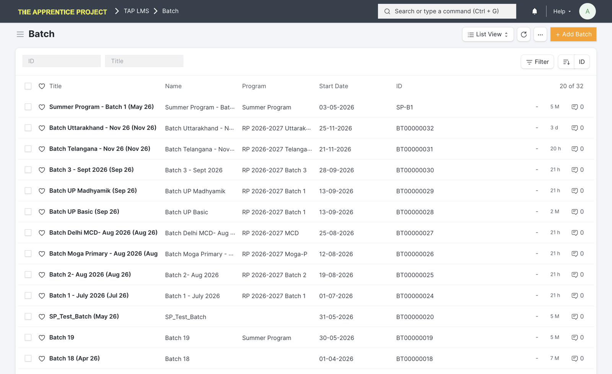

Fill in the batch fields:

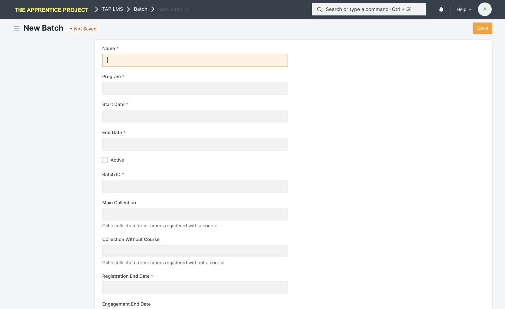

| Field | What to enter |
| --- | --- |
| Name | Display name, for example `Batch Telangana - Nov 26`. The **Title** is filled in automatically from the name and start month. |
| Program | The program this batch belongs to. |
| Start Date / End Date | Batch dates. |
| Active | Tick it while the batch is running. |
| Batch ID | The batch code sent to Glific as `batch_id`. Existing batches use the pattern `BT000000NN` (for example `BT00000031`). |
| Main Collection | Glific collection for students who are registered **with** a course. |
| Collection Without Course | Glific collection for students who are registered **without** a single course. |
| Registration End Date | Required. |
| Current Calendar Week | Required. Use `1` for a new batch. |

Save the batch.

### Step 2: Add the collection names

The two collection fields hold the **exact name of a Glific collection**, written as it appears in Glific. Example from **Batch Telangana - Nov 26**:

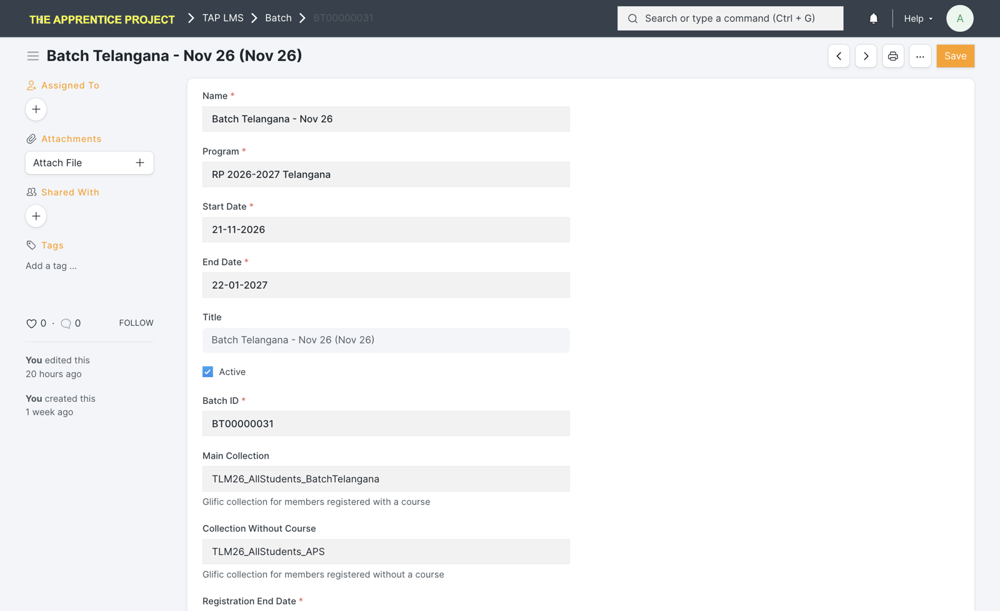

| Field | Example | Used when |
| --- | --- | --- |
| Main Collection | `TLM26_AllStudents_BatchTelangana` | The student's grade maps to **one** course. |
| Collection Without Course | `TLM26_AllStudents_APS` | The grade maps to **several** courses, so the student still has to choose one. |

Several batches can share the same **Collection Without Course** (for example, `TLM26_AllStudents_APS` is used by more than one batch).

> If both collection fields are empty, students in this batch are uploaded to Glific with an **empty collection**. Fill in the collections before schools are enrolled into the batch.

### Step 3: Enroll schools into the batch

Open the **School** and go to the **School Batch Enrollment** table. Add a row for the new batch. A school can have several rows: one for each batch it has joined.

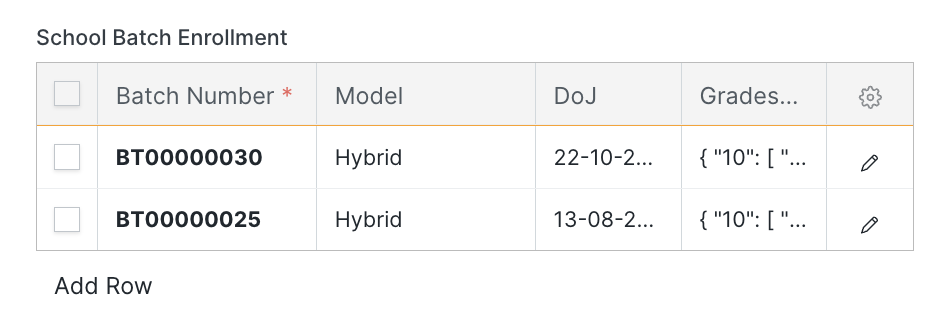

Click the edit icon on a row to see all its fields:

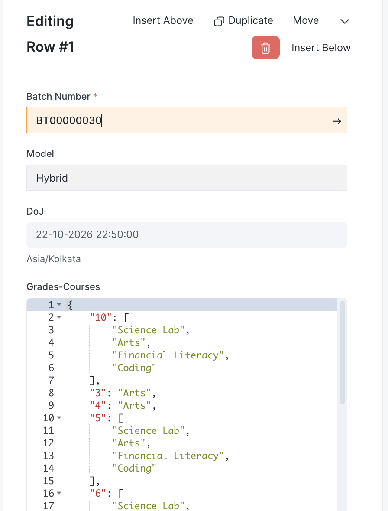

| Field | What it does |
| --- | --- |
| Batch Number | The Batch from Step 1. |
| Model | The TAP model for this school in this batch. It is sent to Glific as `model`. |
| DoJ | Date the school joined this batch. **This decides the batch.** |
| Grades-Courses | JSON that maps each grade to a course or a list of courses. |

#### How DoJ picks the batch

LMS compares each enrollment row's **DoJ** with the signup **timestamp** and uses the row with the **latest DoJ that is on or before the signup**.

Example for the school above:

| Signup timestamp | Batch used |
| --- | --- |
| 20-08-2026 | `BT00000025` (DoJ 13-08-2026) |
| 25-10-2026 | `BT00000030` (DoJ 22-10-2026) |
| 01-08-2026 | None. The row fails with *School Batch Enrollment not found on or before registration timestamp*. |

When a school moves to a new batch, **add a new row** with the new DoJ. Don't overwrite the old row: signups from before the new DoJ still need it.

#### How Grades-Courses picks the course and collection

```json
{
  "3": "Arts",
  "4": "Arts",
  "5": ["Science Lab", "Arts", "Financial Literacy", "Coding"]
}
```

| Student grade | Course | Enrollment vertical | Glific collection |
| --- | --- | --- | --- |
| 3 or 4 | Arts | Arts | **Main Collection** |
| 5 | Four options | Left empty, because the student picks a course later | **Collection Without Course** |

- Course names must match an existing **Course Verticals** record.
- If a grade is missing from the mapping, LMS copies the mapping of the nearest **lower** grade and saves it on the enrollment row. If there is no lower grade either, the row fails with *Course mapping not found for grade …*.

### Batch setup checklist

- [ ] Batch created with **Batch ID**, **Main Collection** and **Collection Without Course** filled in.
- [ ] The collection names match the Glific collection names exactly.
- [ ] Each school has a **School Batch Enrollment** row for the batch with the right **DoJ**, **Model** and **Grades-Courses**.
- [ ] The DoJ is on or before the date students start signing up.

---

## Part 2: Add a new source sheet

A source is one Google Sheet that Glific writes signups into. Open **Student Sheet Registration Source** to see the current sources.

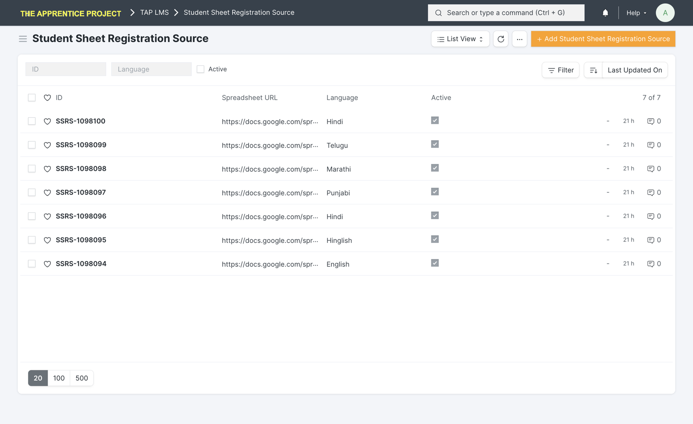

### 1. Prepare the Google Sheet

The tab that is read must have these column headers in the first row. Case, spaces and hyphens don't matter, so `Student Name` matches `student_name`.

| Column | Value |
| --- | --- |
| `timestamp` | Signup date and time. It is compared with the school's batch enrollment DoJ. |
| `contact_phone_number` | 10-digit number, or 12 digits starting with `91`. |
| `student_name` | Student's name. |
| `gender` | `M`, `Male`, `F`, `Female`, and similar values. |
| `grade` | `1` to `12`. |
| `shall_we_begin` | Must be exactly `Agree ✅`. Any other value makes the row skip. |
| `course` | Only when **Has Course Column** is ticked. Must match a Course Verticals name. |

You don't need to add `registration_status` and `process status`. The job adds these columns at the end of the sheet on its first run.

### 2. Share the sheet

Share the Google Sheet with this address as **Editor** (the job writes the status columns back into the sheet):

```text
data-migration@rubrics-data-migration.iam.gserviceaccount.com
```

### 3. Create the source in LMS

Click **+ Add Student Sheet Registration Source** and fill in:

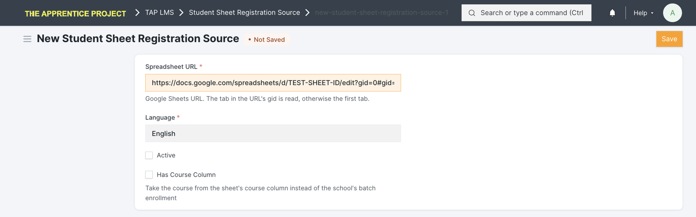

| Field | What to enter |
| --- | --- |
| Spreadsheet URL | The Google Sheet link. The tab in the link's `gid=` is read. If there is no `gid`, the first tab is read. Open the right tab before copying the link. |
| Language | The TAP Language for students in this sheet. |
| Active | Tick it so the daily job reads this sheet. |
| Has Course Column | Tick it only if the sheet has a `course` column. The course is then taken from the sheet instead of the school's Grades-Courses, so these students always go to the batch's **Main Collection**. The batch is still taken from the school's batch enrollment. |

Save the source.

> **Important:** every active source is read in the same run. If one active sheet can't be read (not shared, a wrong link, or a missing column), the whole daily run fails for **all** sheets. Check the sheet before ticking **Active**, and after the next run (Part 3) confirm the job's status is **Completed**.

### Source checklist

- [ ] The sheet has all required columns, plus `course` if **Has Course Column** is ticked.
- [ ] The sheet is shared with the service account as Editor.
- [ ] The Spreadsheet URL points to the right tab (`gid`).
- [ ] The Language is correct.
- [ ] The schools in this sheet have batch enrollments set up (Part 1).

---

## Part 3: Running the job and reading results

### Daily automatic run

The job runs by itself every day at **20:30**. Each run creates:

- A **Student Sheet Registration Job** named `Daily Student Sheet Registration <date> 20:30`.
- A **Student Sheet Registration Cron Log** entry linked to that job.

If a job is still **Preparing** or **Uploading** when the next run starts, the new run is logged as **Skipped**.

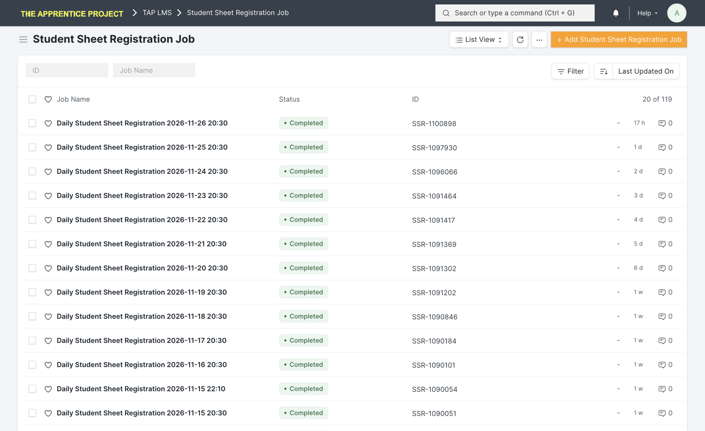

### Running it manually

You only need this if you want the run to happen before 20:30, for example after fixing a batch enrollment.

1. Open **Student Sheet Registration Job** and click **+ Add Student Sheet Registration Job**.
2. Enter a **Job Name** and save.

   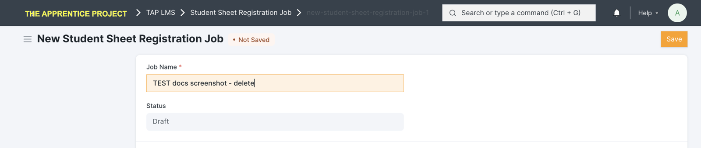

3. Open **Actions → Prepare Data**. LMS reads all active sheets, checks every new row, and writes `Prepared` or the error message into the sheet.

   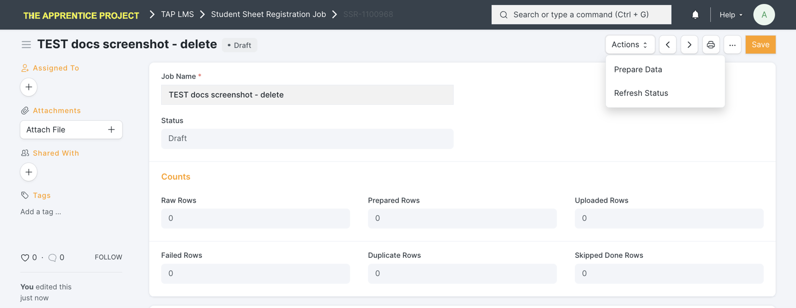

4. Use **Actions → Refresh Status** until the status is **Prepared**. Review the counts and the prepared file.
5. Open **Actions → Complete Upload**. LMS creates or updates the students, adds the enrollments, and uploads the contacts to Glific.
6. Use **Refresh Status** until the status is **Completed**.

> **Prepare Data** and **Complete Upload** work on the real source sheets and real students. Only run them when you intend to register students.

Job status values:

| Status | Meaning |
| --- | --- |
| Draft | Created, not started. |
| Preparing | Reading and checking the sheets. |
| Prepared | Checks done. Waiting for **Complete Upload** (manual runs only). |
| Uploading | Creating students and uploading to Glific. |
| Completed | Finished. |
| Failed | Stopped. See **Last Error** and **Processing Log**. |

### Reading the results

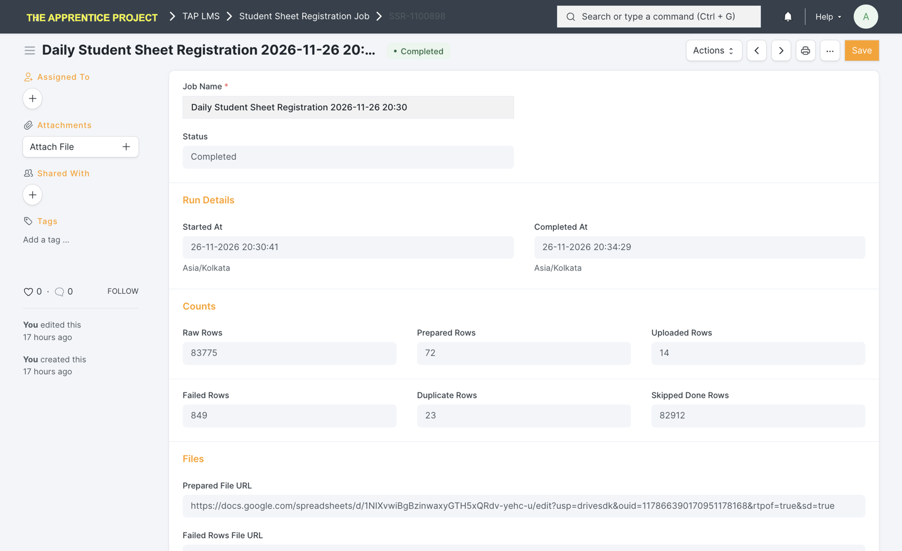

| Count | Meaning |
| --- | --- |
| Raw Rows | All non-blank rows across all active sheets. |
| Skipped Done Rows | Rows already registered in earlier runs. |
| Prepared Rows | New rows that passed every check. |
| Uploaded Rows | Prepared rows that were registered in LMS. |
| Failed Rows | Rows that failed a check or failed during upload. They are tried again in the next run. |
| Duplicate Rows | Rows whose phone number is already registered, or appears twice in the same run. |

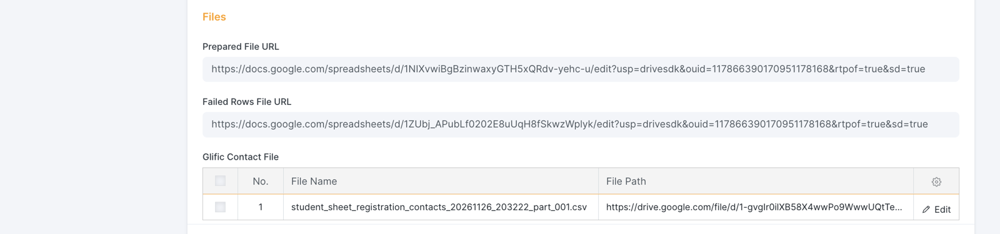

| File | Contents |
| --- | --- |
| Prepared File URL | Sheet of the rows that passed the checks, with the school, batch and course chosen for each. |
| Failed Rows File URL | Sheet of every failed row with its error message. |
| Glific Contact File | CSV sent to Glific, including `batch_id` and `collection` for each student. |
| Summary JSON | Full run summary, including the Glific upload status and the list of sheets read. |

What the job writes in the source sheet:

| `registration_status` | `process status` | Meaning |
| --- | --- | --- |
| `Done` | `complete` | Registered. Skipped in future runs. |
| `Prepared` | `complete` | Passed the checks. The upload step sets the final value. |
| `Duplicate contact_phone_number already registered; …` | `complete` | Phone number already registered from another row. Skipped in future runs. |
| `Duplicate contact_phone_number in current run; …` | `complete` | The same phone number appears in another row in this run. The first valid row is registered. |
| `Skipped: shall_we_begin is not Agree ✅` | `fail` | The student did not agree. |
| Any other message | `fail` | Error. See Troubleshooting. Tried again in the next run. |

### Cron Log

**Student Sheet Registration Cron Log** has one entry per daily run, showing its status and counts. Open an entry to reach the linked job.

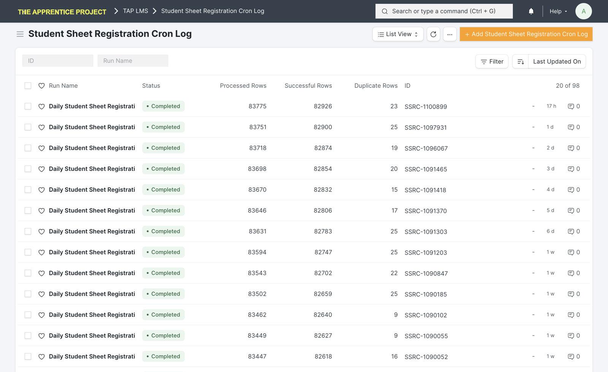

In the cron log, **Successful Rows** = uploaded rows + skipped done rows, and **Failed Rows** excludes duplicates.

---

## Troubleshooting

Row errors (shown in the sheet's `registration_status` column and in the failed rows file):

| Message | Fix |
| --- | --- |
| Student Consent not found and Glific contact school_id not found | The student has no consent record and their Glific contact has no `school_id`. Fix the contact in Glific. |
| School not found: … | The school ID from consent or Glific does not exist in LMS. |
| School Batch Enrollment not found on or before registration timestamp … | Add a School Batch Enrollment row, or correct its **DoJ** so it is on or before the signup. |
| Selected School Batch Enrollment has no batch | Fill in **Batch Number** on the enrollment row. |
| Selected School Batch Enrollment has no grades_courses | Fill in **Grades-Courses** on the enrollment row. |
| Course mapping not found for grade … | Add the grade, or a lower grade, to **Grades-Courses**. |
| Course vertical not found: … | The course name in Grades-Courses or in the sheet doesn't match a **Course Verticals** record. |
| Invalid contact_phone_number / Invalid grade | Fix the value in the sheet. |
| Student is already enrolled in batch BT00000024 or later; new enrollment blocked | The student already has an enrollment in batch `BT00000024` or a later batch, so a new batch enrollment is not added. No action is needed unless the student really should move batches. |

If the job status is **Failed**:

1. Open the job.
2. Check **Last Error** and **Processing Log**.
3. Common causes:
   - An active sheet is not shared with `data-migration@rubrics-data-migration.iam.gserviceaccount.com`.
   - A wrong Spreadsheet URL.
   - A missing required column: *Source sheet is missing required columns*.
   - A Language that doesn't exist in TAP Language.
4. Fix the cause and wait for the next daily run, or run it manually (Part 3).
